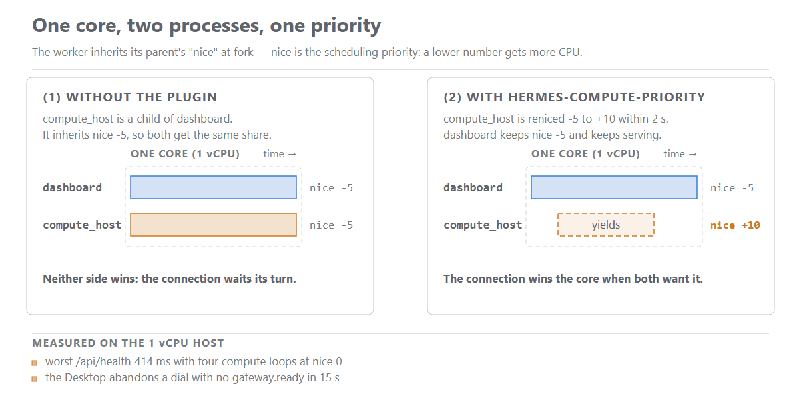

# hermes-compute-priority

A Hermes plugin that keeps the process serving your connection ahead of the processes running your
agents.

## The problem it solves

Hermes can run agent turns in a child process (`dashboard.turn_isolation`). That child is where the
GIL is held while a turn parses a model stream or dispatches tools. The process that answers your
Desktop's WebSocket is its **parent**.

On a small machine, the parent must win — and configuration alone cannot make it:

| Knob | What it arbitrates | Why it is not enough |
|---|---|---|
| `CPUWeight` (systemd) | between **units** | the child lives in the parent's cgroup, so it gets the same share |
| `Nice` (systemd) | between **processes** | niceness is **inherited** at fork/exec: the child starts at the parent's nice and stays there |

Measured on a 1 vCPU host, five dashboard processes across two generations: all at `-5`. The parent
had no priority over its own worker.

So the worker's niceness has to be raised **after** it starts. That needs no privilege — lowering a
process's priority of a process you own is always allowed — and it can never make anything more
urgent than it already was.

## What it does



Every two seconds, in the Hermes process that loaded it:

1. finds processes owned by the same user whose command line contains
   `tui_gateway.compute_host` (how `tui_gateway/host_supervisor.py` spawns a turn worker) — by
   reading `/proc` on Linux, and by asking `psutil` on macOS and Windows;
2. lowers their priority to `+10`, skipping any worker already at or below that value;
3. logs one line per worker, once.

It does nothing else. On a host where turn isolation is off, no worker of that shape exists, so the
plugin is a no-op.

## How scheduling priority works

Priority makes nothing faster: it decides **who yields** when two processes want the same core. POSIX
calls that number `nice` — `-20` to `19`, a larger value meaning less CPU — and Windows uses a
per-process priority class instead, which the plugin maps explicitly. The catch is inheritance: a
child starts at its parent's nice, so a systemd unit cannot separate the two, and the child has to be
lowered *after* it starts. [How scheduling priorities work](docs/priority.md) covers the two layers
(cgroup `CPUWeight` between units, nice between processes), which operation needs a privilege on each
platform, and what this plugin deliberately leaves alone.

## What it does not do

- It does **not** speed up turns: work handed to a worker still costs the same CPU, it just yields
  first.
- It does **not** help sessions whose agent was built in-process (they never use a worker, so there
  is no separate process to deprioritise).
- It is **not** a resource limit. If you want a hard ceiling on a whole process tree, use cgroup
  `CPUQuota` in the unit — this plugin is about *ordering*, not *capping*.

## Install

```bash
hermes plugins install https://github.com/atostivint/hermes-compute-priority
hermes plugins enable hermes-compute-priority
```

Or copy the directory into `<HERMES_HOME>/plugins/hermes-compute-priority/`, run
`hermes plugins enable hermes-compute-priority`, and restart the gateway.

`install` only *offers* to enable — it prompts, and a non-interactive run (CI, Docker, a piped
script) leaves the plugin disabled. Hermes imports a user plugin's backend only when the plugin is
listed in `plugins.enabled`, so the `enable` line is a required step, not a confirmation.

The backend is reached through the dashboard, so the directory has to keep
`dashboard/manifest.json` next to `dashboard/plugin_api.py`. The manifest is what tells the
dashboard to import that file and mount its `router` at `/api/plugins/hermes-compute-priority/`;
without it Hermes skips the plugin silently and the status route below does not exist at all.
`tests/test_dashboard_manifest.py` fails if the manifest disappears or if its `version` drifts
from `plugin.yaml`'s.

The root `__init__.py` exists only to satisfy the plugin loader's shape check — a directory plugin
is "a `plugin.yaml` and an `__init__.py` exposing `register(ctx)`", and Hermes logs
`Failed to load plugin 'hermes-compute-priority'` in `logs/errors.log` without it — and it
registers nothing: the loop is started by the dashboard loader, never by this file.

The plugin works on Linux, macOS and Windows; see [Platforms](#platforms) for what each one does
and for the `psutil` requirement on macOS and Windows.

## Platforms

One contract, three backends (`platform_backend.py`). The observable behaviour is the same
everywhere: the turn workers of the current user are found by command line and lowered, once, with
no privilege and never in the other direction.

| Platform | Enumeration | Priority | Extra dependency |
|---|---|---|---|
| Linux | `/proc/<pid>/cmdline`, `st_uid` for ownership | `os.setpriority` (0–19 niceness) | none |
| macOS | `psutil.Process.cmdline()` | `psutil.Process.nice(10)` (0–19 niceness) | `psutil` |
| Windows | `psutil.Process.cmdline()` | `psutil.Process.nice(<priority class>)` | `psutil` |

`psutil` is already a core hermes-agent dependency, so on those two platforms it is normally
present. It stays **optional for this plugin**: with no `psutil` on macOS or Windows the plugin
loads, enumerates nothing, changes nothing, and says so:

```json
{"ok": true, "enabled": false, "backend": "psutil-win32", "platform": "win32",
 "available": false, "reason": "psutil is not installed, so processes cannot be enumerated on this platform; install it with `pip install psutil` …"}
```

`enabled: false` plus a `reason` is the whole point: a plugin that cannot see processes must not
report a scan loop that is running fine.

### Windows: niceness has no 0–19 scale

On Windows `nice()` reads and writes a **priority class**, not a number between 0 and 19. The
translation is an explicit table, not arithmetic, because it is a policy choice:

| Target niceness | Windows priority class | Meaning |
|---|---|---|
| `15`–`19` | `IDLE_PRIORITY_CLASS` | the lowest class Windows offers |
| `5`–`14` | `BELOW_NORMAL_PRIORITY_CLASS` | clearly behind the serving process |
| `0`–`4` | *(no action)* | NORMAL is the floor the plugin is allowed to ask for |

A target below `5` does nothing on purpose. The only classes left are `NORMAL_PRIORITY_CLASS` (the
ordinary priority — i.e. no change at all) and classes *above* NORMAL, which would make a process
more urgent than the default. This plugin only ever lowers a priority, so anything under 5 is
refused rather than approximated; `/status` reports it in a `note` field when you configure such a
target. The default of `10` lands on `BELOW_NORMAL_PRIORITY_CLASS`.

Reading a class back for the idempotence check is coarse but safe: `IDLE` reads as `19`,
`BELOW_NORMAL` as `10`, and anything at or above `NORMAL` as `0` — low enough that a worker which
somehow outranks NORMAL still gets lowered, never raised. An unrecognised class is skipped.

### Same user, on a platform without `uids()`

`psutil.Process.uids()` is POSIX-only. Where it is missing, the candidate's
`psutil.Process.username()` is compared with this process's own (case-insensitively on Windows,
where account names are case-insensitive). A user name that cannot be read — or our own — means
the candidate is **skipped**, not guessed at: not knowing who owns a process is not a licence to
lower its priority.

## Settings

Environment, read once when the backend is imported:

| Variable | Default | Meaning |
|---|---|---|
| `HERMES_COMPUTE_PRIORITY` | `1` | `0` disables the scan entirely |
| `HERMES_COMPUTE_PRIORITY_NICE` | `10` | target priority for workers: niceness `0`–`19` (`19` is the lowest) on Linux and macOS, translated to a priority class on Windows (see [Platforms](#platforms); `5`–`14` = below normal, `15`–`19` = idle) |
| `HERMES_COMPUTE_PRIORITY_INTERVAL_S` | `2.0` | seconds between scans |
| `HERMES_COMPUTE_PRIORITY_RULES` | *(empty)* | opt-in extra process classes, see below |

## Extra rules — off by default

The plugin knows exactly one class of process until you tell it about others. That is deliberate: a
published plugin must not start deprioritising parts of someone else's Hermes without being asked.

```bash
HERMES_COMPUTE_PRIORITY_RULES='[
  {"name": "mcp",         "match": "mcp-server",              "nice": 15},
  {"name": "plugin-host", "match": "hermes_cli.plugin_host_child", "nice": 8}
]'
```

Each rule is:

| Field | Meaning |
|---|---|
| `name` | a label, for the log line and the status route |
| `match` | a **plain substring** of the command line, **at least 3 characters** — the only stable handle a plugin has, since it may not hook core code |
| `nice` | target niceness, `0`–`19` (on Windows: `5`–`14` = below normal, `15`–`19` = idle, below `5` = no action) |

A `match` shorter than three characters is refused. `"a"` would hit most command lines on the
machine, and a typo must not renice half the box.

Rules are evaluated **in order, and the first match wins**. A process already at or below its target
is skipped, so a rule can never make anything more urgent — and a `nice` below `0` is rejected at
parse time, because raising a priority needs a privilege this plugin does not want.

Anything invalid in the list is dropped silently rather than raising: a typo in an optional feature
must not take down the loop that protects the connection.

### Per-process configuration

The plugin runs **inside** each Hermes process, so "per process" is simply "per unit":

```ini
# hermes-dashboard.service.d/10-scheduling.conf
Environment=HERMES_COMPUTE_PRIORITY_NICE=15

# hermes-gateway.service.d/10-scheduling.conf
Environment=HERMES_COMPUTE_PRIORITY_NICE=5
```

Only the process that actually spawns a worker benefits: today that is the one serving sessions
(the dashboard). Configuring a unit that never isolates turns is harmless and inert.


## Verify it works

```bash
# before a turn that uses an isolated session  (Linux; on macOS: ps -o pid,ppid,ni,command -A)
ps -o pid,ppid,ni,args -C python3 | grep compute_host
```

```powershell
# Windows: the class is what moves, not a 0-19 number
Get-CimInstance Win32_Process -Filter "Name = 'python.exe'" |
  Where-Object { $_.CommandLine -like '*tui_gateway.compute_host*' } |
  ForEach-Object { Get-Process -Id $_.ProcessId | Select-Object Id, PriorityClass }
# -> BelowNormal by default (Idle for a target of 15 or more)
```

The worker should move within a couple of seconds of starting, while the serving process keeps its
own value. The plugin also answers a read-only route:

```bash
# the deployment's session token, or a Bearer token from the auth flow
curl -H "X-Hermes-Session-Token: $HERMES_DASHBOARD_SESSION_TOKEN" \
  http://127.0.0.1:<dashboard port>/api/plugins/hermes-compute-priority/status
```

which reports the target, the scan count, the workers deprioritised so far, the backend in use
(`procfs`, `psutil-posix`, `psutil-win32`) and the last error if any. On a platform where the
backend cannot run, it answers `{"enabled": false, "reason": …}` — read that field before assuming
a plugin that loaded is a plugin that works.

The route sits behind the dashboard's auth gate: nothing under `/api/plugins/` is on the public
allowlist, so a credential-less request gets `401 {"error": "unauthenticated", "detail":
"Unauthorized", ...}` from the gate and never reaches the plugin — a 401 therefore says nothing
about whether the plugin loaded. `dashboard.basic_auth` is a *form* provider (the password is
POSTed to `/auth/password-login`); there is no HTTP Basic, so `curl -u` with that username and
password does not authenticate anything. The gate only reads `Authorization: Bearer <token>`, a
session cookie, or `X-Hermes-Session-Token`, and on `/api/*` it always answers with the 401 JSON
above — never a redirect.

Two proofs need no credentials at all:

```bash
# one line per worker reniced, from the plugin's own file log. The dashboard process installs
# file handlers only and runs uvicorn with log_config=None, so nothing of this reaches the journal.
grep compute-priority /var/lib/hermes-agent/.hermes/logs/agent.log

# the plugin's scan thread, inside the serving process. comm is truncated to 15 characters,
# so "compute-priority" (16) shows up as "compute-priorit".
grep -l compute-priorit /proc/$(systemctl show -p MainPID --value hermes-dashboard)/task/*/comm
```

If both are empty while turn isolation is on, check `hermes plugins list` first — a plugin that is
installed but not enabled never has its backend imported.

## Disclosure

Written the way the Hermes plugin catalog expects:

- **Network:** none. The plugin opens no socket and contacts nothing.
- **Files:** on Linux, reads `/proc/<pid>/cmdline` and `/proc/<pid>/` ownership for processes of
  the same user. On macOS and Windows, enumeration goes through `psutil`, which reads process
  metadata from the OS. Reads nothing in your home directory and writes no file.
- **Processes:** lowers the priority of processes it has already matched **and** that belong to the
  same user — `os.setpriority` on Linux and macOS, `SetPriorityClass` via `psutil` on Windows. It
  never raises a priority, never signals, stops or kills anything, and it skips its own pid.
- **Threads:** one daemon thread inside the Hermes process that loaded it, started at import and
  stopped when that process exits.
- **Credentials:** none read, none stored.
- **Telemetry:** none.

## Limitations, stated plainly

- **Polling, not hooking.** The delay between a worker starting and being deprioritised is up to one
  interval. Hooking the spawn would be exact, but that is core code: a plugin may only use the
  published plugin API.
- **Detection by command line.** If upstream renames the module, the match breaks — loudly in the
  status route (`applied_total` stops moving), silently otherwise.
- **One process.** The plugin acts inside the process that loaded it. If your dashboard and gateway
  are separate units, install it on the one that spawns the workers.
- **Windows granularity.** Three priority classes are coarse next to 20 niceness levels: a target of
  `6` and one of `13` are the same `BELOW_NORMAL_PRIORITY_CLASS`. The direction is always right; the
  step is wider.
- **`psutil` on macOS and Windows.** Without it there is no enumeration, so the plugin stays idle
  and reports why. Linux never needs it.

## The better fix, upstream

`subprocess.Popen(..., preexec_fn=...)` or a `nice=` argument in
`tui_gateway/host_supervisor.py` would make this exact, in one line, without a polling thread (on
Windows the same spawn takes `creationflags=` with a priority class). This plugin exists because
that line is not there yet.

## License

MIT — see [LICENSE](LICENSE).
