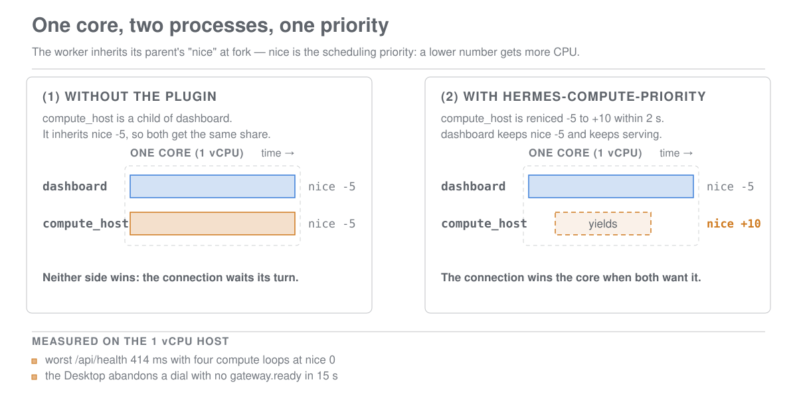

# How scheduling priorities work

*One core, two processes. Without the plugin the worker inherits the parent's priority and competes
on equal terms; with it the worker is lowered after it starts and the process serving the connection
keeps the core.*

This page explains the mechanism the plugin leans on, in the order the pieces fit together. The
[README](../README.md) describes what the plugin does; this is why that works.

## 1. The idea

Priority does not make anything faster. It decides **who yields** when two processes want the same
core at the same moment. On a machine with one core (`1 vCPU`) it is the only variable that matters:
whichever process does not yield waits.

Hermes has exactly that shape. One process serves your Desktop's connection; a child process runs an
agent turn. Both want the core, and only one of them must give way.

## 2. POSIX: `nice`

POSIX exposes the priority as the **nice** value, an integer from `-20` to `19`, `0` by default. The
name is literal — a larger number is a **nicer** process, one that gives way sooner. `-20` is the most
demanding, `19` the most deferential.

Lowering a process's priority, which means writing a *larger* nice value, needs no privilege on a
process you own. Raising it is privileged: `setpriority` answers `EACCES` without `CAP_SYS_NICE`,
unless a suitable `RLIMIT_NICE` soft limit allows it. That asymmetry is the whole reason a plugin can
do this without root.

Nice is not a quota. Under Linux's fair scheduler — CFS, which recent kernels are replacing with
EEVDF, on the same weight table — niceness is converted into a **weight**: nice `0` is `1024`, and
each step multiplies by about `×1.25`. The scheduler divides the core in proportion to the weights of
whatever is runnable. That is an arbitration of who runs first, not a ceiling on how much anyone may
run: when the worker is alone on the core, it still gets all of it.

## 3. Inheritance is the whole problem

A child created by `fork` inherits its parent's nice value, and `execve` preserves it.

One sentence, and the configuration route is closed. `Nice=` on a systemd unit applies to the parent;
the child starts at the parent's value and keeps it. The parent therefore has no priority over its own
worker — they compete on equal terms, whatever the unit says. The only way to separate them is to
change the child's priority **after** it has started, which is what this plugin does, once per `2 s`
scan.

## 4. Two layers, often confused

A cgroup also distributes CPU, but between **units**. In cgroups v2, `cpu.weight` (systemd:
`CPUWeight=`) gives each unit a share of the core in proportion to its weight. Niceness arbitrates
between **processes**, including two processes inside the same unit. And a process forked inside a
unit is born into that unit's cgroup, so the child inherits the parent's cgroup as well as its nice
value.

The two layers answer different questions — *which unit gets the larger slice* and *which process
inside it yields* — and neither replaces the other. A unit weight cannot separate a parent from its
own child. A nice value cannot protect the parent from another unit.

## 5. Windows: classes, not a 0-19 scale

Windows has no nice scale. Each process belongs to a **priority class** — `IDLE`, `BELOW_NORMAL`,
`NORMAL`, `ABOVE_NORMAL`, `HIGH`, `REALTIME` — set with `SetPriorityClass` on a handle opened with
`PROCESS_SET_INFORMATION`, and refined per thread with `SetThreadPriority`. A thread's base priority
is its process's class combined with its own relative level.

Lowering the class of a process you own is ordinary. Going up is not: Microsoft's documentation for
the equivalent WMI call states that setting `REALTIME` requires the `SeIncreaseBasePriorityPrivilege`,
and that without it the highest reachable class is `HIGH`. This plugin never asks for anything above
`NORMAL`.

Since only a handful of classes exist, the plugin translates its niceness target with an explicit
table rather than arithmetic: `nice` at `15` or above becomes `IDLE`, at `5` or above becomes
`BELOW_NORMAL`, and below `5` nothing happens — the classes left are `NORMAL` (no change) and the ones
above it, and this plugin only ever lowers.

## 6. macOS

macOS uses the same BSD scale as POSIX, through `setpriority`. The manual page is explicit about who
may do what: a non-root process that tries to lower a priority gets `EACCES`, and a target owned by
another user gets `EPERM`. Lowering, i.e. a larger nice value, is permitted on the processes you own.

macOS additionally offers `PRIO_DARWIN_BG`, a background state that also throttles disk and network
I/O; this plugin does not use it. Either way, the value is an input to the scheduler, not a
reservation.

## 7. What the plugin does, in one sentence

Every `2 s` it finds the `tui_gateway.compute_host` workers owned by the same user and raises their
niceness to `+10` (`BELOW_NORMAL` on Windows), once per worker — a change that is always permitted,
because it only lowers a priority the plugin already owns.

## 8. What it does not do

- It is not a quota. For a hard ceiling on a whole process tree, use `CPUQuota=` in the unit (cgroups
  v2 `cpu.max`).
- It does not make a turn faster. The same work still costs the same CPU; it just yields first.
- It does nothing where turns are not isolated in a separate process — no worker, nothing to lower.
- It never raises anything: a target nice below `0` is rejected at parse time.

## Sources

- `getpriority(2)`, Linux man-pages: the `-20`..`19` range, the default of `0`, the `EACCES`/`EPERM`
  rules, and `fork`/`execve` inheritance.
- Linux kernel `Documentation/scheduler/sched-nice-design.rst` and `kernel/sched/core.c`
  (`sched_prio_to_weight`: `1024` at nice `0`, the `×1.25` comment).
- Linux kernel `Documentation/admin-guide/cgroup-v2.html`: `cpu.weight`, the weight model, and the
  rule that a forked process is born into its parent's cgroup.
- Microsoft Learn: `SetPriorityClass` (`PROCESS_SET_INFORMATION`), *Scheduling Priorities* (the
  classes and per-thread levels), and `Win32_Process.SetPriority` (`SeIncreaseBasePriorityPrivilege`
  for `REALTIME`).
- `getpriority(2)` / `setpriority(2)`, BSD System Calls Manual (macOS): the BSD scale, `EACCES` and
  `EPERM`.

Back to [the README](../README.md).
